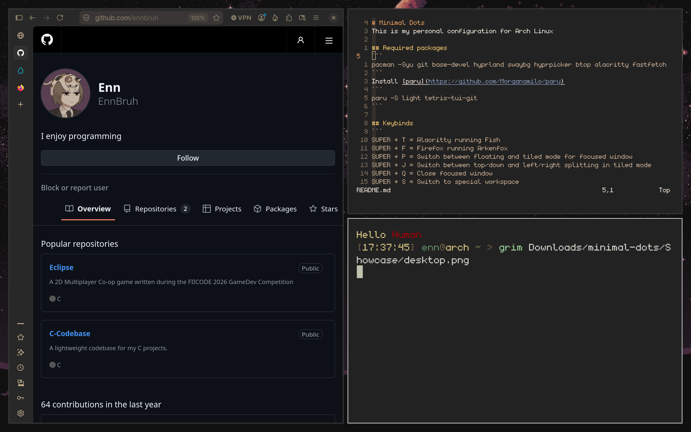

# Minimal Dots
This is my personal configuration for Arch Linux



## Required packages
```
pacman -Syu git base-devel hyprland swaybg hyprpicker btop alacritty fastfetch fish neovim alsa-utils firefox zathura-pdf-poppler zathura unzip texlive manuals grim slurp wl-clipboard xdg-desktop-portal-hyprland 
```
Install [paru](https://github.com/Morganamilo/paru)
```
paru -S light tetris-tui-git
```

## Keybinds
```
SUPER + T = Alacritty running Fish
SUPER + F = Firefox running Arkenfox
SUPER + P = Switch between floating and tiled mode for focused window
SUPER + J = Switch between top/down and left/right splitting in tiled mode
SUPER + Q = Close focused window
SUPER + S = Switch to special workspace 
SUPER + {1..10} = Switch to workspace 1..10
SUPER + arrows = Switch focus to window
SUPER + SHIFT + arrows = Resize focused window
SUPER + ALT + {1..10} = Send focused window to {1..10} workspace
SUPER + ALT + S = Send focused window to special workspace
SUPER + SHIFT + S = Take Screenshot and add to clipboard
```

## Command aliases
```
battery = Query battery percentage for laptop
bright [VALUE] = Set backlight brightness for laptop
audio = Alsamixer for audio volume control
```
